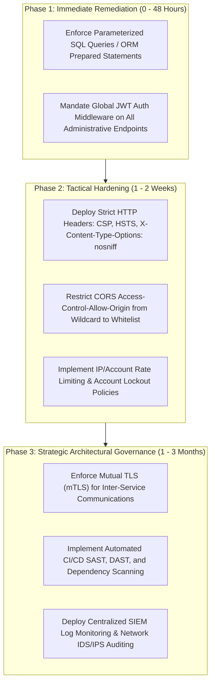

# SWYNEX Technologies — Cyber Security Internship
## Task 4: Comprehensive Defensive Security Assessment Report

[](https://swynex.com)
[](https://github.com/ziyakausar07/SWYNEX-Security-Assessment-Report)
[](#internship-metadata)
[](#executive-summary)

---

### 📋 Internship & Candidate Metadata

| Parameter | Official Record |
| :--- | :--- |
| **Intern Name** | **Ziyakausar J. Tamboli** |
| **Intern ID** | `SWX-2026-002678` |
| **Host Organization** | [SWYNEX Technologies](https://swynex.com) |
| **Domain** | Cyber Security Internship (Defensive Security & Assessment) |
| **Current Stage** | **Task 4: Security Assessment Report (Final Capstone Deliverable)** |
| **Program Timeline** | 17 October 2026 – 16 November 2026 (30 Days) |
| **GitHub Repository** | [SWYNEX-Security-Assessment-Report](https://github.com/ziyakausar07/SWYNEX-Security-Assessment-Report.git) |

---

## 🎯 Executive Overview & Capstone Objective

**Task 4: Security Assessment Report** represents the culminating capstone deliverable of the **SWYNEX Cyber Security Internship**. The objective of this project is to synthesize, cross-correlate, and rigorously document the empirical defensive security findings acquired across the three preceding hands-on internship domains:

1. **Task 1: Security Fundamentals Assessment** — Evaluating foundational web security controls, REST API authorization boundaries, HTTP defense-in-depth response headers, and remediating unauthorized administrative API access on an Orphanage Management System.
2. **Task 2: Network Security Analysis** — Multi-layer packet capture inspection, OSI layer dissection, TCP transport state auditing, TLS 1.2/1.3 cryptographic negotiation analysis, and traffic anomaly identification using Wireshark.
3. **Task 3: Web Security Review** — Comprehensive application security testing of OWASP Top 10 vulnerabilities (Security Misconfiguration, Reflected XSS input handling, SQL Injection authentication bypass, Authentication error mechanics, and Broken Access Control) on a containerized OWASP Juice Shop environment.

This capstone repository consolidates all verified findings into an **enterprise-grade, defensive security assessment report** incorporating standardized vulnerability scoring (CVSS v3.1), threat impact analysis, sanitized visual evidence archives, and prioritized remediation blueprints.

> **Data Sanitization & Compliance Note:** In strict compliance with SWYNEX submission guidelines, all sensitive credentials, internal tokens, IP addresses, and private configuration artifacts have been completely redacted, masked, or generated within authorized, non-production sandbox environments.

---

## 🏗️ Repository Architecture

```text
SWYNEX-Security-Assessment-Report/
│
├── README.md                                          # Executive overview, summary matrix & repository index
├── LINKEDIN_POST.md                                   # Complete LinkedIn explanation & submission post template
│
├── reports/                                           # Compiled Master Assessment Reports
│   ├── SWYNEX_Defensive_Security_Assessment_Report.md # Full 360-degree technical assessment master report
│   ├── SWYNEX_Executive_Summary.md                    # Executive C-level brief & risk governance report
│   └── SWYNEX_Final_Security_Assessment_Report.html   # Publication-ready, printable interactive HTML report
│
├── documentation/                                     # In-Depth Assessment Subsystems
│   ├── 01_Executive_Summary_and_Scope.md              # Scope, authorization boundaries, and target assets
│   ├── 02_Methodology_and_Frameworks.md               # Standards alignment (OWASP ASVS, NIST SP 800-115)
│   ├── 03_Consolidated_Vulnerability_Findings.md       # Granular technical breakdown of all observed findings
│   ├── 04_Risk_Analysis_and_Threat_Matrix.md          # Composite CVSS v3.1 metrics & DREAD threat modeling
│   └── 05_Remediation_Roadmap_and_Defensive_Architecture.md # Tactical and strategic defense-in-depth roadmap
│
└── evidence/                                          # Structured Sanitized Visual Proof Archive
    ├── task1-fundamentals/                            # Task 1: API auth bypass & remediation evidence
    │   ├── 01_Admin_Dashboard_Login.png
    │   ├── 02_Before_Security_Fix.png
    │   ├── 03_After_Security_Fix.png
    │   └── 04_Dashboard_After_Fix.png
    │
    ├── task2-network/                                 # Task 2: Wireshark packet captures & TLS dissections
    │   ├── 01_main_packet_capture_overview.png
    │   ├── 02_protocol_hierarchy_statistics.png
    │   ├── 03_conversations_ethernet_layer2.png
    │   ├── 04_conversations_ipv4.png
    │   ├── 05_conversations_ipv6.png
    │   ├── 06_conversations_tcp_sessions.png
    │   ├── 07_conversations_udp_traffic.png
    │   ├── 08_filter_tcp_syn_flag.png
    │   ├── 09_tcp_syn_packet_details.png
    │   ├── 10_filter_tls_handshake_sni.png
    │   ├── 11_filter_endpoint_all_packets.png
    │   ├── 12_client_hello_detailed_parameters.png
    │   ├── 13_server_hello_cipher_negotiation.png
    │   ├── 14_filter_tcp_retransmission_check.png
    │   ├── 15_filter_tcp_duplicate_ack_check.png
    │   ├── 16_filter_tcp_fin_check.png
    │   ├── 17_filter_tcp_reset_check.png
    │   └── 18_follow_tcp_stream_encrypted_payload.png
    │
    └── task3-web/                                     # Task 3: OWASP Juice Shop web security review evidence
        ├── 01_Security_Misconfiguration.png
        ├── 02_XSS_Testing.png
        ├── 03A_SQL_Injection_Payload.png
        ├── 03B_SQL_Injection_Success.png
        ├── 04A_Authentication_Registration.png
        ├── 04B_Authentication_Invalid_Credentials.png
        ├── 05A_Access_Control_LoggedIn.png
        └── 05B_Access_Control_LoggedOut.png
```

---

## 📊 Consolidated Security Risk & Findings Matrix

The table below synthesizes the empirical security observations recorded across the entire 4-task assessment lifecycle:

| Finding ID | Assessment Domain | Target Component | Vulnerability / Observation | CVSS v3.1 Base | Severity | Status / Outcome |
| :---: | :--- | :--- | :--- | :---: | :---: | :---: |
| **SEC-01** | **Task 1: Fundamentals** | `GET /api/admin/dashboard` | Broken Authentication / Missing Role Authorization | **8.2** | `HIGH` | **Remediated** via `@role_required("ADMIN")` |
| **SEC-02** | **Task 1: Fundamentals** | HTTP Response Headers | Missing Defense-in-Depth Headers (`CSP`, `nosniff`) | **4.3** | `MEDIUM` | Documented & Hardening Rules Provided |
| **NET-01** | **Task 2: Network** | Data Link / Transport Stack | IPv6 & TLS Dominance (94.8% IPv6, 71.3% TLS Payload) | **Informational** | `INFO` | Baseline Validated; Full Payload Confidentiality |
| **NET-02** | **Task 2: Network** | Cryptographic Handshake | TLS 1.3 Negotiation (`TLS_AES_256_GCM_SHA384`, SNI) | **Informational** | `INFO` | Verified Cryptographically Secure |
| **NET-03** | **Task 2: Network** | Wire Stability & Flags | TCP Retransmissions & Resets Audit (`RST=0`, `FIN=0`) | **Informational** | `INFO` | Healthy Session Management Verified |
| **WEB-01** | **Task 3: Web Security** | HTTP Response Headers | Missing `Content-Security-Policy` & Wildcard CORS | **5.4** | `MEDIUM` | Defensive CSP & CORS Policy Engineered |
| **WEB-02** | **Task 3: Web Security** | Search Parameter (`q`) | Reflected Input Handling (Defensive Output Encoding) | **4.1** | `LOW` | Validated Safe Handling & Context Encoding |
| **WEB-03** | **Task 3: Web Security** | Login Authentication Form | SQL Injection Authentication Bypass (`' OR 1=1--`) | **8.6** | `HIGH` | Verified Vulnerable; Parameterized Queries Engineered |
| **WEB-04** | **Task 3: Web Security** | Login Credential Validation | Username Enumeration Resistance ("Invalid email/password") | **Informational** | `LOW` | **Verified Secure** Error Handling |
| **WEB-05** | **Task 3: Web Security** | `/rest/user/whoami` Endpoint | Authorization Token Session Boundary Check | **Informational** | `LOW` | **Verified Secure** Data Boundary |

---

## 🔍 Core Security Pillar Breakdown

### Pillar 1: Security Fundamentals & API Access Control (Task 1)
- **Target:** Orphanage Management System (`https://orphanage-management-system-iota.vercel.app/`)
- **Key Vulnerability:** The administrative metrics endpoint (`GET /api/admin/dashboard`) returned HTTP 200 OK and sensitive administrative data without requiring an `Authorization` Bearer token header.
- **Defensive Engineering:** Authored and integrated server-side middleware enforcing the `@role_required("ADMIN")` decorator, validating JWT integrity and role claims before granting execution access.
- **Verification:** Retesting unauthenticated requests yielded an immediate rejection response: `{"message": "Authorization header missing"}` (HTTP 401), while authorized administrators experienced uninterrupted dashboard telemetry.

### Pillar 2: Network Traffic & Protocol Security Analysis (Task 2)
- **Platform & Scope:** Wireshark Network Protocol Analyzer on controlled Windows 11 host.
- **Key Protocols Audited:** Ethernet II, IPv6/IPv4, TCP, UDP, TLS 1.2/1.3, mDNS, SSDP, ICMPv6.
- **Analytical Insights:**
  - Complete absence of legacy plaintext web protocols (`http` display filter matched 0 packets).
  - DNS resolution on legacy UDP 53 yielded 0 packets, indicating DNS-over-HTTPS (DoH) utilization or OS-level DNS cache optimization.
  - Granular dissection of TLS 1.3 Client Hello and Server Hello handshakes confirmed strong modern cipher suites (`TLS_AES_256_GCM_SHA384`), elliptic curve key exchanges (x25519), and Server Name Indication (SNI) host validation.
  - Follow TCP Stream reconstruction confirmed complete cryptographic confidentiality of application layer payloads.

### Pillar 3: Web Security & OWASP Top 10 Review (Task 3)
- **Target:** OWASP Juice Shop (`http://localhost:3000`) in an authorized local sandbox.
- **Key Vulnerabilities & Audits:**
  - **SQL Injection (High):** Submitting `' OR 1=1--` into the email field on `/rest/user/login` bypassed password authentication entirely, elevating the session to administrator privileges and solving the "Login Admin" challenge.
  - **Security Misconfiguration (Medium):** Absence of `Content-Security-Policy` and `Strict-Transport-Security` headers exposed user agents to cross-site scripting risks and unencrypted downgrade vectors.
  - **Defensive Resilience (Positive Findings):** Target demonstrated robust defense against user enumeration by returning a standardized, non-descriptive error message (*"Invalid email or password"*) and strictly withheld user identity details on `/rest/user/whoami` when unauthenticated (`{"user":{}}`).

---

## 🛡️ Strategic Defense-in-Depth Roadmap



---

## 📖 Complete Documentation Index

For comprehensive details, refer to the specialized documentation files:

- 📄 **[Master Security Assessment Report](reports/SWYNEX_Defensive_Security_Assessment_Report.md)** — Complete 360-degree technical assessment.
- 📑 **[Executive Summary Brief](reports/SWYNEX_Executive_Summary.md)** — CISO and management-oriented summary.
- 🌐 **[Interactive HTML Assessment Report](reports/SWYNEX_Final_Security_Assessment_Report.html)** — Formatted for web viewing and PDF printing.
- 🔬 **[Executive Scope & Context](documentation/01_Executive_Summary_and_Scope.md)**
- 📐 **[Methodology & Compliance Standards](documentation/02_Methodology_and_Frameworks.md)**
- 🚨 **[Granular Vulnerability Findings](documentation/03_Consolidated_Vulnerability_Findings.md)**
- 📈 **[Risk Scoring & CVSS Threat Matrix](documentation/04_Risk_Analysis_and_Threat_Matrix.md)**
- 🛠️ **[Defense-in-Depth Remediation Roadmap](documentation/05_Remediation_Roadmap_and_Defensive_Architecture.md)**
- 💼 **[LinkedIn Post & Demo Guide](LINKEDIN_POST.md)**

---

## ⚖️ Ethics, Compliance & Authorization Statement

All assessment activities, network captures, API tests, and vulnerability validations documented herein were performed strictly within authorized, isolated local laboratory environments or dedicated training platforms approved under the SWYNEX Technologies Cyber Security Internship curriculum. No unauthorized access, denial-of-service, production testing, or scanning against external or third-party infrastructure occurred. All visual evidence has been sanitized to prevent disclosure of sensitive credentials or operational data.

---

<div align="center">
  <p><b>SWYNEX Technologies — Cyber Security Internship Capstone Deliverable</b></p>
  <p>Prepared with dedication by <b>Ziyakausar J. Tamboli</b> (<code>SWX-2026-002678</code>)</p>
</div>
