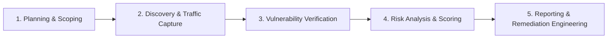

# Section 2: Methodology & Testing Frameworks
## SWYNEX Cyber Security Internship — Task 4 Capstone

---

## 1. Defensive Testing Methodology

The assessment adopted a blended methodology combining manual verification, protocol analysis, and standard vulnerability discovery workflows. The methodology aligns with the **NIST SP 800-115** (Technical Guide to Information Security Testing and Assessment) lifecycle:

### 1.1 Phase 1: Planning & Scoping
- Defined authorization boundaries and identified target domains.
- Prepared testing platforms (Wireshark protocol analyzer, Google Chrome DevTools, local Node.js Juice Shop environment, Postman/curl).

### 1.2 Phase 2: Discovery & Protocol Analysis
- **Network Traffic Capture:** Ingested raw packet streams to establish baseline communication hierarchies, identify unencrypted protocols, and audit network conversation pairs.
- **Surface Mapping:** Mapped web application endpoints, inspection of HTTP request/response lifecycles, and reviewed client-side JavaScript behaviors.

### 1.3 Phase 3: Vulnerability Verification & Exploitation Simulation
- **Authentication & Authorization Testing:** Evaluated route protection by manipulating HTTP headers and session tokens.
- **Input Validation Testing:** Injected crafted payloads (SQL injection strings, script tags) into web input vectors to evaluate server-side handling.
- **Protocol Handshake Dissection:** Decomposed TCP handshakes and TLS 1.3 cryptographic parameters to verify transport privacy and cipher strength.

### 1.4 Phase 4: Risk Analysis & CVSS Scoring
- Mapped all empirical observations against the **Common Vulnerability Scoring System (CVSS v3.1)** to generate objective, standardized severity ratings.
- Evaluated business impact using the **DREAD** threat modeling model.

### 1.5 Phase 5: Defensive Remediation & Verification Retesting
- Authored code-level fixes (e.g., Python Flask route decorators, parameterized SQL queries).
- Deployed remediations and executed regression re-tests to mathematically verify flaw elimination.

---

## 2. Industry Standards Alignment

### 2.1 OWASP Top 10 (2021 Edition)
The application-layer assessments in Tasks 1 and 3 were mapped against OWASP Top 10 vulnerability categories:
- **A01:2021 — Broken Access Control:** Inspected under Task 1 (admin dashboard API access) and Task 3 (`/rest/user/whoami` endpoint).
- **A03:2021 — Injection:** Evaluated under Task 3 (SQL Injection authentication bypass on the login dialog).
- **A05:2021 — Security Misconfiguration:** Evaluated across Tasks 1 and 3 (inspection of HTTP security response headers and CORS).
- **A07:2021 — Identification & Authentication Failures:** Evaluated under Task 3 (login credential validation and error messaging).

### 2.2 OWASP Application Security Verification Standard (ASVS v4.0.3)
- **V2: Authentication:** Verification of secure credential handling and resistance to credential guessing/enumeration.
- **V4: Access Control:** Verification that administrative functions enforce role-based authorization checks server-side.
- **V5: Validation, Sanitization, and Encoding:** Verification that database queries utilize parameterized interfaces to prevent injection attacks.
- **V14: Configuration:** Verification that defense-in-depth security headers are actively returned across all responses.

### 2.3 IETF RFC Protocol Standards
- **RFC 793 / RFC 7323:** Transmission Control Protocol (TCP) specification, sequence numbering, and window scale options.
- **RFC 8446:** The Transport Layer Security (TLS) Protocol Version 1.3 (Elliptic-curve key exchanges, cipher negotiation, and zero plaintext application records).
- **RFC 6797:** HTTP Strict Transport Security (HSTS).
