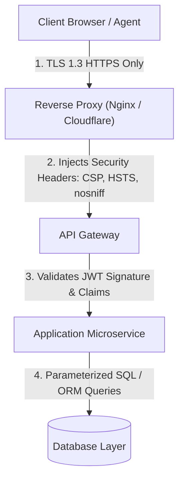

# Section 5: Remediation Roadmap & Defensive Architecture
## SWYNEX Cyber Security Internship — Task 4 Capstone

---

## 1. Defensive Architectural Vision

To transition from identified vulnerabilities to a hardened enterprise security posture, systems must adopt a **Defense-in-Depth** and **Zero Trust Architecture (ZTA)** approach. Trust should never be assumed implicitly based on network location; every request must be authenticated, authorized, and cryptographically verified.



---

## 2. Granular Remediation Specifications

### 2.1 Remediation 1: Parameterized SQL Queries & ORM Usage (Neutralizing SQLi)
- **Vulnerability Addressed:** WEB-01 (SQL Injection Authentication Bypass).
- **Core Principle:** Separate executable query logic from untrusted user data.

#### Insecure Pattern (Vulnerable String Concatenation):
```javascript
// DO NOT USE: Vulnerable to SQL Injection
const query = `SELECT * FROM Users WHERE email = '${email}' AND password = '${password}'`;
db.query(query);
```

#### Secure Implementation Pattern (Parameterized Prepared Statements):
```javascript
// SECURE: Parameterized Query with Prepared Statements
const query = `SELECT id, email, role, profileImage FROM Users WHERE email = ? AND password = ? AND deletedAt IS NULL`;
db.query(query, [email, hashedEnteredPassword], (err, results) => {
  if (err) return res.status(500).json({ error: "Internal Server Error" });
  if (results.length === 0) {
    return res.status(401).json({ error: "Invalid email or password." });
  }
  // Proceed with JWT issuance...
});
```

---

### 2.2 Remediation 2: Global API Authentication Middleware
- **Vulnerability Addressed:** SEC-01 (Broken Access Control on Admin Endpoints).
- **Core Principle:** Deny by default; enforce explicit authentication and role checks on all non-public routes.

```python
# SECURE: Flask / Python Route Guard
@app.before_request
def enforce_default_security():
    # Allow public endpoints (login, registration, health)
    if request.path in ["/api/auth/login", "/api/auth/register", "/healthz"]:
        return None
    
    auth_header = request.headers.get("Authorization")
    if not auth_header or not auth_header.startswith("Bearer "):
        return jsonify({"error": "Unauthorized: Authentication required"}), 401
    
    token = auth_header.split(" ")[1]
    try:
        claims = jwt.decode(token, APP_SECRET, algorithms=["HS256"])
        request.user = claims
    except (jwt.ExpiredSignatureError, jwt.InvalidTokenError):
        return jsonify({"error": "Unauthorized: Invalid or expired token"}), 401
```

---

### 2.3 Remediation 3: Standardized HTTP Defense-in-Depth Headers
- **Vulnerability Addressed:** WEB-02 & SEC-02 (Security Misconfiguration).
- **Core Principle:** Instruct user agents to enforce strict browser security boundaries.

#### Recommended Nginx Configuration:
```nginx
# Add Security Headers Across All HTTP Responses
add_header Strict-Transport-Security "max-age=31536000; includeSubDomains; preload" always;
add_header Content-Security-Policy "default-src 'self'; script-src 'self' 'nonce-rAnd0m'; style-src 'self' 'unsafe-inline'; img-src 'self' data:; font-src 'self'; frame-ancestors 'none'; base-uri 'self'; form-action 'self';" always;
add_header X-Content-Type-Options "nosniff" always;
add_header X-Frame-Options "DENY" always;
add_header Referrer-Policy "strict-origin-when-cross-origin" always;
add_header Permissions-Policy "camera=(), microphone=(), geolocation=(), payment=()" always;

# Restrict Permissive CORS
add_header Access-Control-Allow-Origin "https://app.swynex.com" always;
add_header Access-Control-Allow-Methods "GET, POST, PUT, DELETE, OPTIONS" always;
add_header Access-Control-Allow-Headers "Authorization, Content-Type" always;
```

---

### 2.4 Remediation 4: Transport Layer Cryptographic Hardening
- **Vulnerability Addressed:** NET-01 & NET-02 (Network Security Maintenance).
- **Core Principle:** Enforce modern cryptographic standards across all external and internal listeners.
- **Actions:**
  - Enforce TLS 1.3 and TLS 1.2 with secure AEAD cipher suites (`TLS_AES_256_GCM_SHA384`, `ECDHE-ECDSA-AES256-GCM-SHA384`).
  - Disable legacy protocols (SSLv2, SSLv3, TLS 1.0, TLS 1.1) and broken ciphers (RC4, 3DES, CBC-mode ciphers).
  - Adopt DNS-over-HTTPS (DoH) or DNS-over-TLS (DoT) to protect domain resolution from local network eavesdropping.

---

## 3. Defense Implementation Roadmap

```text
+-------------------+---------------------------------------------------------+--------------------+
| Implementation    | Actions & Milestones                                    | Target Completion  |
+-------------------+---------------------------------------------------------+--------------------+
| Phase 1: Patch    | 1. Deploy parameterized queries for login.              | 0 - 48 Hours       |
| (Immediate P0)    | 2. Enforce @role_required("ADMIN") across all APIs.     |                    |
+-------------------+---------------------------------------------------------+--------------------+
| Phase 2: Harden   | 1. Implement HSTS, CSP, and X-Content-Type-Options.     | 1 - 2 Weeks        |
| (Short-Term P1)   | 2. Replace wildcard CORS with strict domain whitelist.  |                    |
|                   | 3. Implement IP and account login rate limiting.        |                    |
+-------------------+---------------------------------------------------------+--------------------+
| Phase 3: Govern   | 1. Integrate Semgrep / Snyk SAST into GitHub Actions.  | 1 - 3 Months       |
| (Strategic P2)    | 2. Configure OWASP ZAP automated baseline scans.        |                    |
|                   | 3. Implement centralized SIEM log telemetry (ELK/Splunk)|                    |
+-------------------+---------------------------------------------------------+--------------------+
```
