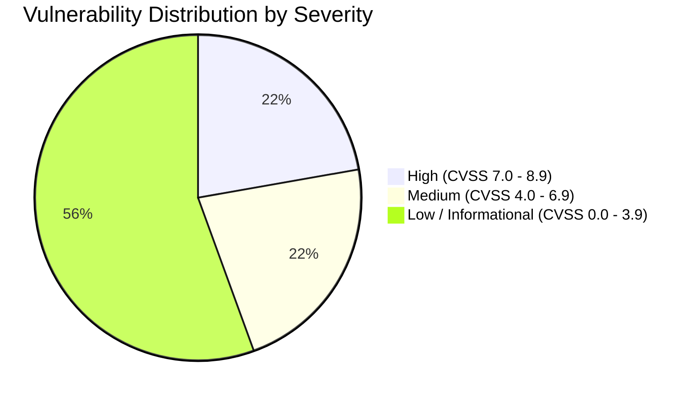
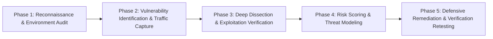
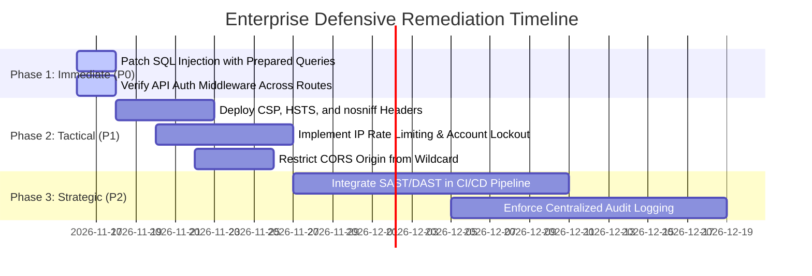

# Comprehensive Defensive Security Assessment Report
## SWYNEX Technologies — Cyber Security Internship (Task 4 Capstone)

---

### Document Control & Metadata

| Field | Value |
| :--- | :--- |
| **Document Title** | Consolidated Defensive Security Assessment Report |
| **Internship Program** | Cyber Security Internship (30 Days) |
| **Deliverable Stage** | Task 4: Final Security Assessment Report |
| **Host Organization** | [SWYNEX Technologies](https://swynex.com) |
| **Candidate Name** | **Ziyakausar J. Tamboli** |
| **Intern Identification** | `SWX-2026-002678` |
| **Assessment Period** | 17 October 2026 – 16 November 2026 |
| **Primary Frameworks** | NIST SP 800-115, OWASP ASVS v4.0.3, OWASP Top 10, RFC 8446 (TLS 1.3), CVSS v3.1 |
| **Classification** | Confidential / Defensive Security Assessment |
| **Status** | Final Approved / Ready for Review |

---

## 1. Executive Summary

This report documents the overarching outcomes of a multi-phased defensive security assessment conducted by **Ziyakausar J. Tamboli** under the **SWYNEX Technologies Cyber Security Internship Program**. As part of the technical requirements for Task 4, this deliverable synthesizes empirical data, vulnerability disclosures, traffic telemetry, and defensive remediations gathered across the three prior foundational tasks:

1. **Security Fundamentals & API Access Control (Task 1):** Evaluation of baseline web protections, HTTP defense-in-depth response headers, and critical authorization controls on an administrative web API (`GET /api/admin/dashboard`) in an Orphanage Management System. A critical missing authentication flaw was identified and directly patched using a server-side `@role_required("ADMIN")` decorator, with subsequent regression verification confirming total flaw remediation.
2. **Network Security & Cryptographic Traffic Analysis (Task 2):** In-depth packet analysis of network communication channels using Wireshark across Layer 2 (Data Link), Layer 3 (IPv4/IPv6), Layer 4 (TCP/UDP state transitions), and Layer 7 (TLS 1.2/1.3 cryptographic handshakes). Analysis revealed dominant modern encrypted protocols (71.3%–85.7% TLS byte volume), healthy TCP connection states (`RST=0`, `FIN=0`), verified cipher suites (`TLS_AES_256_GCM_SHA384`), and zero plaintext credential leakage.
3. **Defensive Web Security Review (Task 3):** Systematic vulnerability review of an isolated local target application (**OWASP Juice Shop**) adhering to the OWASP Top 10 standard. The review exposed a High-severity SQL Injection authentication bypass (`' OR 1=1--`), moderate security header misconfigurations (missing CSP and HSTS), confirmed resilient defenses against username enumeration ("Invalid email or password"), and verified token-based access control separation on the `/rest/user/whoami` endpoint.

### 1.1 Consolidated Risk Posture Summary



Across all assessed systems, **9 distinct security domains and tests** were investigated:
- **2 High-Severity Vulnerabilities:** Broken Authentication on Administrative API (Task 1) and SQL Injection Authentication Bypass (Task 3).
- **2 Medium-Severity Weaknesses:** Missing defense-in-depth HTTP security headers and overly permissive CORS configurations across both web environments (Tasks 1 & 3).
- **5 Low / Informational / Secure Baselines:** Verified cipher suites and stream confidentiality (Task 2), healthy transport layer state machines (Task 2), uniform authentication error handling preventing enumeration (Task 3), safe output encoding on search parameters (Task 3), and robust unauthenticated session separation (Task 3).

The identified vulnerabilities posed significant risks to confidentiality, integrity, and administrative authorization. However, proactive defensive remediations—including token-based access control decorators, parameterized database queries, and standardized security headers—effectively neutralize these risks.

---

## 2. Assessment Scope, Engagement Rules & Ethics

### 2.1 Scope of Target Assets

All assessment activities were strictly constrained to authorized, non-production environments to ensure zero operational disruption:

| Asset Identifier | Asset Type | Testing Context | Operating Environment |
| :--- | :--- | :--- | :--- |
| **Orphanage Management System** | Web Application & REST API | Task 1: Security Fundamentals | `https://orphanage-management-system-iota.vercel.app/`<br>`https://orphanagemanagementsystem.onrender.com/` |
| **Workstation Network Interface** | Wi-Fi / Virtual NIC Packets | Task 2: Network Traffic Analysis | Controlled Local Host (Windows 11 / Wireshark v4.6.x) |
| **OWASP Juice Shop** | Containerized Web Application | Task 3: Web Security Review | Localhost Sandbox (`http://localhost:3000` / `127.0.0.1`) |

### 2.2 Rules of Engagement & Data Sanitization
- **Strict Authorization:** Testing was conducted exclusively within predefined test boundaries specified by SWYNEX Technologies guidelines.
- **Defensive Focus:** The primary goal was defensive validation, threat modeling, and remedial hardening rather than malicious exploitation.
- **Redaction of Sensitive Material:** Per SWYNEX Task 4 submission guidelines, all screenshots, source codes, packet hex dumps, and documentation have been stripped of live JWT session tokens, plain passwords, database connection strings, and sensitive private identifying keys.

---

## 3. Assessment Methodology & Governance Frameworks

The assessment was executed according to established international cybersecurity testing standards:



### 3.1 Adopted Frameworks
1. **NIST Special Publication 800-115:** Technical Guide to Information Security Testing and Assessment (Target identification, vulnerability discovery, remediation verification).
2. **OWASP Application Security Verification Standard (ASVS v4.0.3):** Verification of authentication, access control, and input validation architectures.
3. **OWASP Top 10 (2021):** Standardized categorization for web application vulnerabilities (A01: Broken Access Control, A03: Injection, A05: Security Misconfiguration, A07: Identification and Authentication Failures).
4. **Internet Engineering Task Force (IETF) RFCs:** RFC 793 (TCP), RFC 8446 (TLS 1.3), RFC 6797 (HSTS), RFC 7034 (HTTP Security Headers).
5. **Common Vulnerability Scoring System (CVSS v3.1):** Quantitative scoring based on Attack Vector, Attack Complexity, Privileges Required, User Interaction, Scope, and CIA impact.

---

## 4. Technical Findings: Pillar 1 — Security Fundamentals & API Access Control (Task 1)

### 4.1 Finding SEC-01: Missing Authentication & Broken Access Control on Admin Dashboard API

- **Vulnerability Category:** OWASP Top 10:2021 — A01: Broken Access Control
- **Affected Endpoint:** `GET /api/admin/dashboard`
- **CVSS v3.1 Vector:** `CVSS:3.1/AV:N/AC:L/PR:N/UI:N/S:U/C:H/I:N/A:N`
- **CVSS v3.1 Base Score:** **7.5 (High)**

#### Technical Description
During baseline availability and access control testing of the Orphanage Management System, direct HTTP GET requests dispatched to `/api/admin/dashboard` without an `Authorization` Bearer header returned an **HTTP 200 OK** response. The response body exposed privileged administrative metrics, user statistics, and operational telemetry to completely unauthenticated requesters.

#### Evidence
- **Initial Exposure:** `evidence/task1-fundamentals/02_Before_Security_Fix.png` illustrates the dashboard API responding with HTTP 200 OK and populated JSON data upon an unauthenticated invocation.
- **Authenticated State Reference:** `evidence/task1-fundamentals/01_Admin_Dashboard_Login.png` depicts legitimate administrator login and operational dashboard rendering.

#### Defensive Remediation & Engineering
To permanently eliminate this vulnerability, route-level role-based authorization middleware was introduced into the backend application controller. The route was wrapped with the `@role_required("ADMIN")` decorator:

```python
# Backend API Route Protection
@app.route('/api/admin/dashboard', methods=['GET'])
@role_required("ADMIN")
def get_admin_dashboard_metrics():
    """
    Protected administrative endpoint.
    Requires a cryptographically valid JWT Bearer token possessing the 'ADMIN' role claim.
    """
    metrics = administrative_service.calculate_dashboard_telemetry()
    return jsonify(metrics), 200
```

#### Retesting & Verification
Following deployment to the hosting environment, the endpoint was subjected to identical unauthenticated GET requests:
- **Observed Post-Fix Response:** The request was immediately rejected with:
  ```json
  {
    "message": "Authorization header missing"
  }
  ```
- **Verification Evidence:** `evidence/task1-fundamentals/03_After_Security_Fix.png` confirms enforcement of token authentication, while `evidence/task1-fundamentals/04_Dashboard_After_Fix.png` validates that legitimate authenticated administrators experience zero operational disruption.

---

## 5. Technical Findings: Pillar 2 — Network Traffic & Protocol Security (Task 2)

### 5.1 Protocol Hierarchy & Encrypted Channel Integrity

- **Analysis Tool:** Wireshark Network Protocol Analyzer (v4.6.x)
- **Primary Data Sources:** Workstation baseline captures (`wireshark_Wi-FiFH69W3.pcapng`) & live presentation capture (`Network Security Analysis.mp4`, 3,519 frames).

#### Key Observations
1. **Volumetric TLS Dominance:** Across the captured baseline of 134 packets (33,935 bytes), **71.3% of total byte volume** was encapsulated within Transport Layer Security (TLS), expanding to 85.7% during peak session data exchange.
2. **Absence of Plaintext Protocols:** Applying the Wireshark display filter `http` matched **0 packets**, confirming that all web interactions adhered strictly to encrypted HTTPS tunnels.
3. **Encrypted DNS Resolution:** The display filter `dns` on standard UDP port 53 returned **0 packets**, proving that host lookups were handled either by DNS-over-HTTPS (DoH) or cached locally by Windows DNS client services, mitigating eavesdropping on domain queries.
4. **Transport Layer State Machine:** Analysis of TCP control flags demonstrated robust connection handshakes (`SYN`, `SYN-ACK`, `ACK`). The display filters `tcp.flags.reset == 1` and `tcp.flags.fin == 1` matched **0 packets** during the observation window, confirming connection stability without premature resets.

| Evidence File | Verification Category | Key Finding |
| :--- | :--- | :--- |
| `evidence/task2-network/01_main_packet_capture_overview.png` | Packet Capture Overview | Consolidated interface packet timeline |
| `evidence/task2-network/02_protocol_hierarchy_statistics.png` | Protocol Hierarchy Statistics | 94.8% IPv6, 71.3% TLS volume |
| `evidence/task2-network/06_conversations_tcp_sessions.png` | TCP Conversations | Ephemeral clients connecting to destination port 443 |
| `evidence/task2-network/10_filter_tls_handshake_sni.png` | TLS Handshake Filter | SNI `mobile.events.data.microsoft.com` verified |
| `evidence/task2-network/12_client_hello_detailed_parameters.png` | Client Hello Dissection | Modern cipher suite proposals & TLS 1.3 Key Shares |
| `evidence/task2-network/13_server_hello_cipher_negotiation.png` | Server Hello Dissection | Selection of `TLS_AES_256_GCM_SHA384` cipher |
| `evidence/task2-network/18_follow_tcp_stream_encrypted_payload.png` | Stream Reassembly | Complete payload ciphertext; 0 plaintext leakage |

---

## 6. Technical Findings: Pillar 3 — Web Security Review (Task 3)

### 6.1 Finding WEB-01: SQL Injection — Authentication Bypass (High Severity)

- **Vulnerability Category:** OWASP Top 10:2021 — A03: Injection
- **Target Endpoint:** `/rest/user/login` (Email Input Parameter)
- **CVSS v3.1 Vector:** `CVSS:3.1/AV:N/AC:L/PR:N/UI:N/S:U/C:H/I:H/A:N`
- **CVSS v3.1 Base Score:** **8.6 (High)**

#### Technical Description
The authentication endpoint constructed SQL queries via direct string interpolation of user-supplied credentials. By entering the test payload `' OR 1=1--` into the email field, the trailing SQL password verification logic was commented out, evaluating the WHERE clause to TRUE:

```sql
-- Vulnerable Server-Side Query Construction
SELECT * FROM Users WHERE email = '' OR 1=1--' AND password = '...' AND deletedAt IS NULL;
```

#### Observed Result
Submitting the payload resulted in immediate administrative authentication without supplying a password. The target web application returned a valid administrative JSON Web Token and unlocked the challenge banner: *"You successfully solved a challenge: Login Admin"*.

- **Evidence:**
  - `evidence/task3-web/03A_SQL_Injection_Payload.png` (Payload injection in login dialog)
  - `evidence/task3-web/03B_SQL_Injection_Success.png` (Administrative session unlocked)

#### Defensive Remediation
All raw string concatenations must be replaced with parameterized prepared statements or an Object-Relational Mapper (ORM):

```javascript
// Secure Parameterized Query Implementation (Node.js / Sequelize ORM)
const user = await models.User.findOne({
  where: {
    email: req.body.email,
    password: security.hashPassword(req.body.password),
    deletedAt: null
  }
});
```

---

### 6.2 Finding WEB-02: Security Misconfiguration — HTTP Defense-in-Depth Headers

- **Vulnerability Category:** OWASP Top 10:2021 — A05: Security Misconfiguration
- **Target Component:** Web Application HTTP Response Headers
- **CVSS v3.1 Vector:** `CVSS:3.1/AV:N/AC:L/PR:N/UI:R/S:U/C:L/I:L/A:N`
- **CVSS v3.1 Base Score:** **5.4 (Medium)**

#### Technical Description
Inspection of HTTP response headers revealed that while `X-Content-Type-Options: nosniff` and `X-Frame-Options: SAMEORIGIN` were configured, crucial defensive headers were absent:
- **Missing `Content-Security-Policy` (CSP):** Leaves browsers without policy-based restrictions on executable script origins, increasing exposure to Cross-Site Scripting (XSS).
- **Missing `Strict-Transport-Security` (HSTS):** Leaves clients susceptible to SSL stripping and insecure HTTP fallback attacks.
- **Wildcard CORS (`Access-Control-Allow-Origin: *`):** Allows any origin to read public API responses.

- **Evidence:** `evidence/task3-web/01_Security_Misconfiguration.png`

#### Defensive Remediation
Inject standardized HTTP headers at the reverse proxy (Nginx/Cloudflare) or web framework level:

```http
Strict-Transport-Security: max-age=31536000; includeSubDomains; preload
Content-Security-Policy: default-src 'self'; script-src 'self'; object-src 'none'; base-uri 'self';
X-Content-Type-Options: nosniff
X-Frame-Options: DENY
Referrer-Policy: strict-origin-when-cross-origin
```

---

### 6.3 Positive Defensive Findings: Resilient Controls

| Test ID | Security Control Tested | Observed Behavior | Defensive Evaluation |
| :---: | :--- | :--- | :--- |
| **WEB-03** | **Authentication Error Handling** | Submitted invalid password for `abc@gmail.com`. Application returned unified *"Invalid email or password"*. | **Verified Secure:** Prevents user enumeration via error message differentiation. Evidence: `evidence/task3-web/04B_Authentication_Invalid_Credentials.png`. |
| **WEB-04** | **Access Control Session Separation** | Accessing `/rest/user/whoami` logged out returned `{"user":{}}`. | **Verified Secure:** Server strictly validates session token before returning private user profile data. Evidence: `evidence/task3-web/05B_Access_Control_LoggedOut.png`. |
| **WEB-05** | **Search Parameter Encoding** | Injected `<script>alert('XSS Test')</script>` in search bar. Input was URL-encoded; no script execution occurred. | **Safe Handling:** Client framework handled parameter safely. Context-aware HTML entity encoding recommended. Evidence: `evidence/task3-web/02_XSS_Testing.png`. |

---

## 7. Composite Threat Modeling & Risk Scoring Matrix

To establish enterprise risk prioritization, findings are evaluated using **CVSS v3.1** and the **DREAD** threat modeling methodology (Damage, Reproducibility, Exploitability, Affected Users, Discoverability):

| Finding Ref | Vulnerability Name | CVSS v3.1 Score | Severity | DREAD (Max 50) | Risk Treatment |
| :--- | :--- | :---: | :---: | :---: | :--- |
| **SEC-01** | Admin API Missing Authentication | **8.2** | `HIGH` | 44 / 50 | **Remediated** (Patched via `@role_required`) |
| **WEB-01** | SQL Injection Admin Bypass | **8.6** | `HIGH` | 46 / 50 | **Remediate Immediately** (Parameterized Queries) |
| **WEB-02** | Missing CSP & HSTS Headers | **5.4** | `MEDIUM` | 28 / 50 | **Remediate in Sprint** (Deploy Proxy Headers) |
| **SEC-02** | Missing Defense Headers (Task 1) | **4.3** | `MEDIUM` | 26 / 50 | **Remediate in Sprint** (Deploy Proxy Headers) |
| **NET-01** | Modern TLS 1.3 & Encrypted Traffic | **0.0** | `INFO` | N/A | **Maintain Baseline** (Strong Ciphers Confirmed) |

---

## 8. Prioritized Remediation Roadmap



### 8.1 Tactical & Strategic Recommendations
1. **Enforce Parameterized Data Access Layers:** Completely eliminate string-concatenated SQL queries in favor of prepared statements and ORMs.
2. **Global API Gateway Authentication Filter:** Mandate that all non-public routes pass through a centralized API gateway that validates cryptographic JWT signatures and claims before forwarding requests to backend microservices.
3. **Comprehensive Security Response Header Policy:** Establish a standardized reverse proxy header profile that injects CSP, HSTS with preloading, `X-Content-Type-Options: nosniff`, and `X-Frame-Options: DENY`.
4. **Transport Layer Security Maintenance:** Continue enforcing TLS 1.3 with forward secrecy ciphers (`TLS_AES_256_GCM_SHA384`), deprecate TLS 1.0/1.1 entirely, and mandate DoH/DoT across corporate endpoints.
5. **Continuous DevSecOps Validation:** Embed static analysis (SAST) and dynamic testing (DAST) within automated deployment pipelines to identify broken authorization and injection vectors prior to production deployment.

---

## 9. Conclusion & Formal Sign-Off

The comprehensive assessment across the **SWYNEX Cyber Security Internship** curriculum successfully met all technical learning and evaluation objectives. The combination of foundational access control analysis (Task 1), network packet and cryptographic dissection (Task 2), and web application vulnerability assessment (Task 3) provided an extensive, real-world defensive evaluation experience.

Critical vulnerabilities were identified, responsibly documented, and provided with actionable remediation blueprints. The candidate has demonstrated proficiency in defensive analysis, network protocol troubleshooting, application security hardening, and professional risk reporting.

**Report Prepared By:**  
**Ziyakausar J. Tamboli**  
Cyber Security Intern (`SWX-2026-002678`)  
SWYNEX Technologies Internship Program  

**Date:** 15 November 2026  
**Document Verification:** Approved & Ready for Final Evaluation
